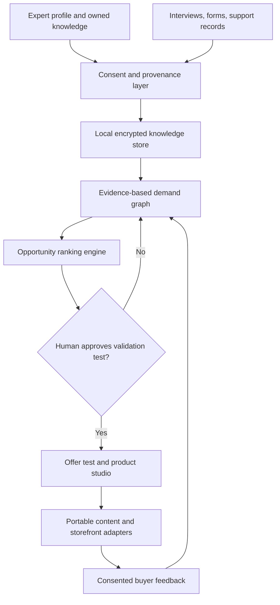

# ExpertOS architecture: ambitious target, small honest core

## Why this is difficult

The challenge is not generating content. A language model can do that easily. The hard parts are identifying a real, costly problem, preserving the expert's unique point of view, validating that someone would pay, measuring educational/customer outcomes, and keeping private source information out of output.

## Proposed system (not yet implemented)

## Present technical slice

- `src/core.js`: pure deterministic ranking and test-plan generation. 5 weighted signals sum to 100%; repeated source IDs do not inflate evidence; unverified ideas are capped at 45/100.
- `src/cli.js`: reads a local JSON file; no network calls, keys or database.
- `examples`: invented case study with explicit fictional labels.
- `tests`: built-in Node test runner.

The numeric weights are a **design hypothesis**, not scientifically validated market predictors. A score is **relative prioritization**, never an estimate of revenue, success probability, or demand.

## Potential future components

- **Evidence store**: append-only event model, source URI, collection consent, redaction state, citation map, and expiration/deletion policy.
- **Agent runtime**: small task-specific agents (problem extraction, offer writer, product editor, accessibility reviewer), each with narrow tool scopes.
- **Model portability**: adapters for local models and user-provided inference keys; opt-in cloud processing only.
- **Export**: Markdown, JSON Schema, SCORM or EPUB when appropriate, and static websites.
- **Payment layer**: adapters, never storing card numbers or unnecessary PII.
- **Independent evaluation**: measure how often product drafts remain supported by cited evidence, plus educator-reviewed quality rubrics.

## Security constraints for later versions

All customer content is untrusted input. Defend against prompt injection, keep tool permissions narrow, scrub PII in logs, require human approval before external writes, and track source deletion through derived outputs. Do not ingest third-party DMs or customer lists without permission. Accessibility and localization (including Indian languages) should be designed in, not patched in later.
